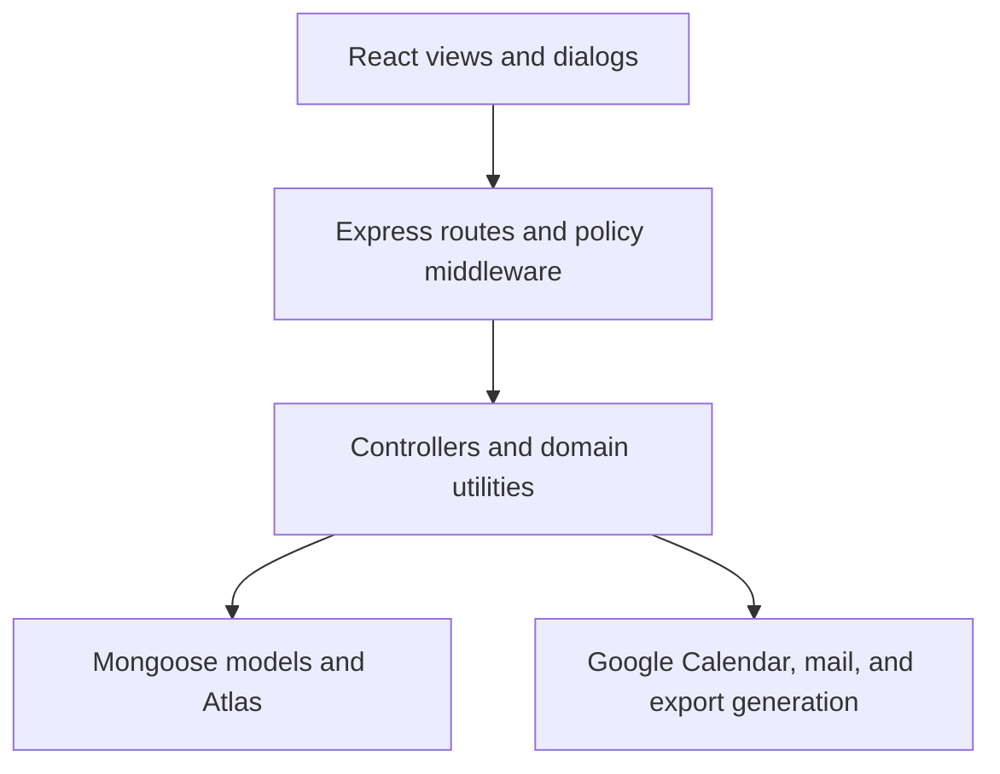
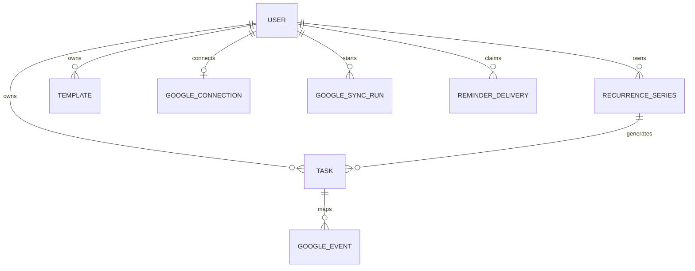
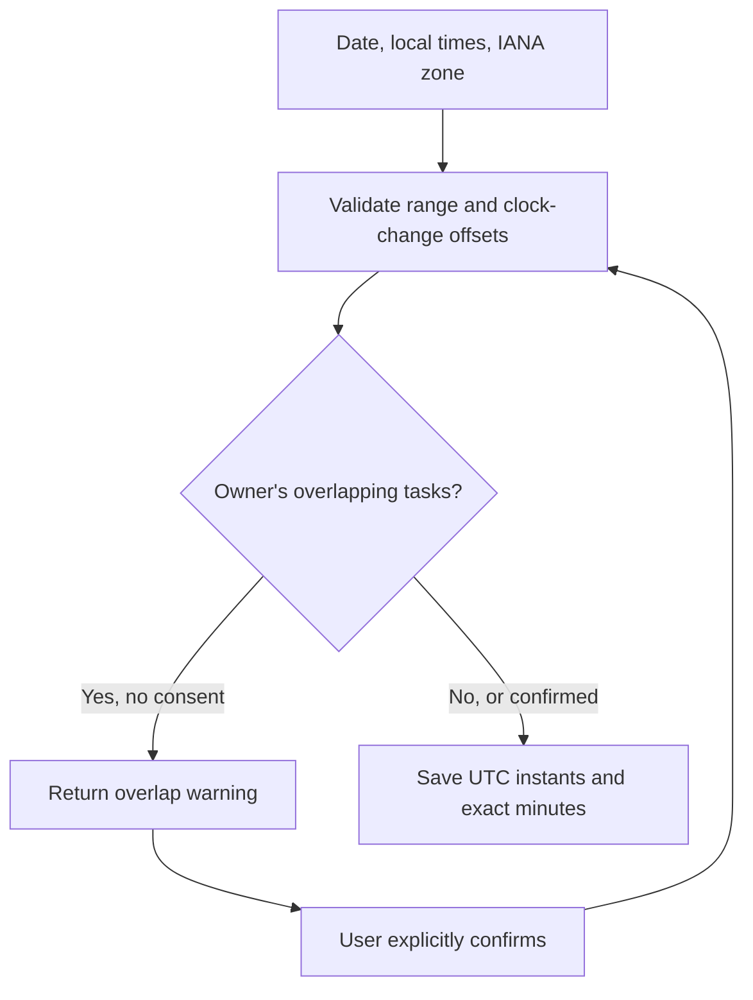

# Planora architecture

React is the View layer. Express controllers implement request workflows, Mongoose schemas are Models, and route/middleware modules keep dispatch, authentication, validation, and policy separate. Shared calendar helpers provide consistent exact-time ranges and overlap layout. This is a modular MERN application, not separate microservices.

## Models and ownership

- **User:** bcrypt password hash, session version, private categories, saved preferences/timezone, status/role, verification/recovery hashes. Private token/hash fields are excluded from normal queries/responses.
- **Task:** owner, title/notes, category ID, priority/status/location, civil date/clock values and UTC instants, occurrence identity, exception/deletion markers, embedded movement history and per-date plan ledger. History is not a separate collection.
- **RecurrenceSeries:** owner, repeat rule and local scheduling definition. A unique owner/series/original-occurrence-date index prevents duplicate occurrence identities.
- **Template:** owner and reusable task values; applying creates an independent task.
- **GoogleConnection/OAuthState/Event/SyncRun:** encrypted credentials/state, persisted mappings, bounded job/result state, and resumable leases. Google events belong to the dedicated app-created calendar.
- **ReminderDelivery:** unique owner/device/key claim plus TTL expiry. Each browser/device may claim independently.
- **SiteSettings:** singleton registration/reminder policies, new-account defaults, revision, and role-change transaction guard.
- **AdminAudit:** administrative actor/target/action/version metadata, with no personal task content or credentials.

## Exact-time scheduling and overlap consent

Intervals are half-open: adjacent tasks do not overlap. Local 09:15–09:55 retains 40 wall-clock minutes and the corresponding UTC instants. Elapsed duration uses UTC differences across valid clock transitions. Nonexistent/ambiguous start or end times are rejected. A task cannot cross midnight; split overnight work into separate dates. Day/week rows are derived from actual task boundaries rather than fixed hour slots. Each day has its own rows, compact gaps, and readable minimum heights; labels retain exact local ranges and elapsed minutes. Overlap groups keep distinct task identities. Rendering height is not an elapsed-time axis.

## Authentication and coordination

The browser sends host-only HttpOnly session cookies. Production uses Secure and SameSite=Lax. State-changing requests require the canonical Origin plus `X-Planora-Client: web`. Every private lookup is owner-scoped. Administrator role checks precede a separate current-password unlock; administrative metadata does not grant personal task inspection.

Each Node process serializes account writes with an in-memory queue. Target-account administrative changes additionally take that account's queue and a Mongo transaction. Google mutation routes retain the lock until their asynchronous external mutation finishes even if the client disconnects. This is why the supplied deployment is one process/instance. Mongo transactions and unique indexes enforce important persistent invariants; the queue itself is not distributed.

## Recurrence, review, and progress

Queries generate only bounded dates. Monthly missing dates are skipped with explicit warnings; completed and individually changed occurrences survive whole-series edits. Moving an occurrence preserves its original slot identity. Deletion markers prevent resurrection. Review permits explicit keep/bucket/delete only after the user's local day ends. Ledger snapshots retain earlier daily placements; legacy records disclose their history boundary rather than inventing old events.

## Exports and integration

One owned range/filter query feeds PDF, CSV, and ICS. CSV escapes cells and neutralizes formula prefixes; PDFs use bundled Unicode fonts. ICS is a bounded snapshot with stable UIDs, timezones, repeat/exclusion handling, and optional alarms. Importing that snapshot is separate from Google API mappings.

Google is manual one-way Planora → Google. PKCE, single-use browser-bound state, scoped authorization, authenticated token encryption, persisted event IDs, per-task outcomes, and retry/pause controls cover the external workflow. Direct Google edits do not change Planora; a later explicit sync overwrites managed fields.

Browser reminders poll with server time, revalidate the current owned task and enabled policies, then atomically claim before requesting a page notification. Claims provide at-most-once delivery attempts per browser/device; closed browsers and failed OS delivery are outside that guarantee. Account emails use local development previews, TLS SMTP, or fixed-provider HTTPS transport.
